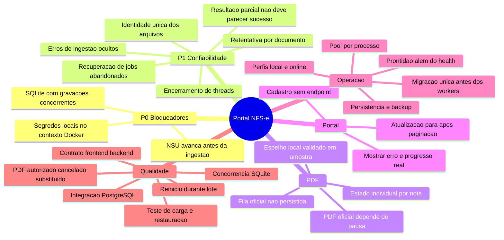

# Revisao tecnica e mapa de correcoes

Data: 2026-09-16. Escopo: backend, integracao com frontend local, persistencia,
worker, DANFSe, configuracao de execucao, Docker e CI.

Conclusao: ainda nao liberar para producao. A geracao de PDF funciona e a
concorrencia local recebeu uma primeira correcao, mas existem riscos de
retomada, observabilidade e empacotamento que a suite atual nao detecta.

## Correcoes aplicadas em 2026-09-17 (segunda rodada)

Auditado contra o working tree real em 2026-09-17, sobre o commit `f50da54`.
Validado com consulta real ao ADN em SQLite local: o job que antes morria em
~6 minutos no NSU 800 passou a consumir o backlog (NSU 3700+, 1000+ notas
ingeridas ao vivo) sem nenhum `database is locked`. Suite: 209 testes.

- **Causa raiz confirmada do `database is locked` (P0-1 e P1-8).** Eram tres
  mecanismos sobrepostos, todos reproduzidos em execucao:
  1. Deadlock cruzado entre o `_SQLITE_WRITE_LOCK` (RLock em `flush`/`commit`
     da `PortalSession`) e o lock de escrita do SQLite: a thread principal
     entrava em `flush()` segurando o RLock e esperava o `busy_timeout` (60 s)
     pela thread de ingestao, que para liberar precisava de `commit()`, que
     precisava do RLock. Cinco tentativas de 60 s = os ~6 minutos observados.
     O RLock foi removido (`db/session.py`); ele causava o problema que
     tentava evitar.
  2. Thread de ingestao incremental sobrevivendo ao `join(timeout=10)` e
     gravando em paralelo com o fecho do job. `ingerir_saida_legado` ganhou
     `should_stop` (cancelamento cooperativo por linha) e o join passou a
     aguardar a parada de fato (`INGESTAO_JOIN_TIMEOUT`, depois `join()`).
  3. Escritas em `nsu_controle` pela sessao longa com snapshot defasado
     (SQLITE_BUSY_SNAPSHOT, recusado na hora sem respeitar `busy_timeout`).
     Todas as gravacoes de NSU e da reconciliacao passaram a sessao propria
     com retentativa (`_gravar_nsu_em_sessao_curta`,
     `executar_escrita_com_retry`); `renovar_snapshot()` e chamado antes dos
     blocos de escrita da sessao longa; a ingestao pos-processamento passou a
     usar `commit_every=20` e commit explicito, para nao segurar o lock de
     escrita com centenas de linhas pendentes.
  4. `BEGIN IMMEDIATE` foi tentado e revertido: com sessoes curtas aninhadas
     na mesma thread, toda leitura vira write-lock e o deadlock e garantido.
- **202 notas baixadas e ausentes do portal** (fotografia: 227 no
  `index_nfse.csv`, 25 no banco). Recuperadas com
  `reconciliar_notas_certificados` (151 importadas, 0 erros; as demais ja
  tinham entrado pela ingestao incremental). Comando documentado no README.
- **Falha silenciosa de certificado.** `list_certificados_elegiveis` engolia
  `SecretsServiceError`; com `SECRETS_KEY` errada o certificado sumia da fila
  sem mensagem. Agora registra `logger.error` com orientacao.
- **Worker cancelava consulta pontual.** `processar_proximo_job` cancelava
  todo job cujo grupo estivesse com `automatico_ativo=False`, matando a
  consulta iniciada com `automatico=false`. Passa a olhar o status do
  proprio processo.
- **`options.limite` como teto de certificados por ciclo** em
  `enqueue_consultas_pendentes`: removido; e o teto de consultas NSU do job.
- **Grupos fixados no startup.** `_supervisionar_grupos` (main.py) sobe
  workers para grupos criados depois da inicializacao (varredura a cada 60 s).
- **PHP so configurado por `iniciar_local.py`.** Extraido para
  `core/php_runtime.py::configurar_php()`; scripts de manutencao e o proprio
  `iniciar_local.py` usam o mesmo caminho. Sem isso, no Windows, a geracao
  falhava com `mime_content_type()` indefinido.
- **`.env` ausente** era a razao da API nao subir (`ENVIRONMENT=production`
  exige API_KEY/JWT_SECRET/SECRETS_KEY). `iniciar_local.py` agora falha com
  mensagem explicita; README documenta a geracao das chaves.
- **Segredos reais de producao em `.env.docker.example`** (Supabase, JWT,
  API_KEY, SECRETS_KEY, R2, Invertexto, Resend), commitados em `a4a00b6` e ja
  no remoto. Arquivo substituido por placeholders. **Todas essas credenciais
  precisam ser rotacionadas**; a `SECRETS_KEY` nova exige recadastrar as
  senhas dos certificados.
- `.env.example` completado (R2_*, NOTAS_DATA_CORTE, WORKER_ADN_LOTE,
  WORKER_PDF_OFFICIAL_*, PDF_STATUS_REVALIDATION_*). BOM removido do
  Dockerfile. Codigo morto e scripts de competencia encerrada removidos
  (`legacy_adapter.py`, `*_202608.py`, apresentacoes).
- Testes de regressao em `tests/test_concorrencia_sqlite.py`: parada
  cooperativa da ingestao, retentativa, prova isolada do BUSY_SNAPSHOT e
  `renovar_snapshot`.

- **Fecho do job regenerava todos os PDFs.** A ingestao pos-processamento
  chamava o PHP para cada linha da corrida e so depois via que o espelho ja
  existia no storage (~1,5 s x 1.600 notas = ~40 min com o processo
  "rodando" e nenhum contador avancando). Agora verifica o storage antes e
  reutiliza o PDF quando a nota nao precisa de carimbo novo.
- **PDF oficial removido do codigo** (decisao do produto em 2026-09-17: a API
  DANFSe do ADN foi desativada). Sairam: fila e download durante a pausa e no
  fecho do job, `baixar_pdfs_oficiais_periodo`, `revalidar_status_pdfs` (task
  de startup, configs `PDF_STATUS_REVALIDATION_*`), `pdf_status_service`,
  comando `danfse` do CLI legado, `baixar_pdf_oficial` dos requests e configs
  `WORKER_PDF_OFFICIAL_*`. Permanecem: a coluna `processos.baixar_pdf_oficial`
  (NOT NULL sem default no servidor; o modelo grava sempre False) e toda a
  leitura de arquivos `pdf_oficial` ja existentes (listagem, download, filtro
  `status_nota_pdf`). P1-6 encerrado por remocao.

Gargalos de escala observados com py-spy, ainda abertos (P1, nao bloqueiam):
- `adn_nfse_downloader.upsert_indexes` rele e reescreve `index_nfse.csv`
  inteiro a cada documento (O(n^2)); com 1.600 linhas cada consulta ADN fica
  perceptivelmente mais lenta.
- A pre-varredura de eventos em `ingerir_saida_legado` parseia todos os XMLs
  do indice a cada chamada da ingestao incremental (a cada 1-3 s).

### Compatibilidade com o frontend (`Frontend-Portal-NSU`, commit `0fd4b07`)

Cruzamento do OpenAPI do backend com todas as chamadas de `src/lib/api.ts`:
as 62 rotas usadas existem (duas, `/auth/local` e `/auth/criar-conta`, sao
`include_in_schema=False`). Contratos comparados campo a campo. Ajustes:

- **`/auth/local` devolvia 404 com `iniciar_local.py`**: a rota exigia
  `not is_production`, mas o script roda como production. O login automatico
  do frontend em localhost nunca funcionava. A rota passou a usar a mesma
  guarda de perfil local do `criar-conta` (`LOCAL_SIGNUP_ENABLED` + SQLite +
  storage local + host local). `conftest.py` fixa `LOCAL_SIGNUP_ENABLED=false`
  para a suite nao depender do `.env` do desenvolvedor.
- Frontend lia `job.erro`; o backend envia `erro_resumo` (`ProcessoDrawer`).
  Tipo `ProcessoJob` alinhado ao `JobRead`.
- RBAC: o backend tem `papel` (admin/operador/leitura) e `require_operator`
  em 5 rotas; o frontend so conhecia `is_admin`. Adicionados `Usuario.papel`,
  `podeOperar` no `useAuth`, gating em Motor ADN / StartConsultasButton /
  cancelar processo / salvar conferencia, e seletor de papel no Admin
  (envia `papel`, que o PATCH ja aceitava).
- Removidos `baixar_pdf_oficial` (request) e `resetar_fila` (nunca existiu
  no backend) dos tipos do frontend. `Processo.baixar_pdf_oficial` ficou
  opcional.
- Validado com o backend real: auto-login, CORS para `localhost:5173`,
  listagem/total de notas, jobs, arquivos, download do PDF espelho,
  conferencia e desativar consultas. `npm run check` (audit, vitest, tsc,
  build) passa.

### Sincronizacao de eventos por nota (novo)

`services/eventos_sync_service.py` + `POST /notas/{id}/sincronizar-eventos`
(operador) + `scripts/sincronizar_eventos_lote.py` + botao "Verificar eventos
no ADN" no drawer da nota. Consulta `/NFSe/{chave}/Eventos` com o certificado
da empresa e reaproveita `_registrar_evento_xml` e
`_regenerar_pdf_espelho_evento`. Validado contra o ADN real: o endpoint devolve
a propria NFS-e (`TipoDocumento=NFSE`) antes dos eventos; a nota e contada em
`nota_retornada` e nao e tratada como evento. Testes em
`tests/test_eventos_sync.py`.

### Deploy de 2026-09-17 (Railway `daring-flexibility` / Supabase)

- Commits `44c6e72` e `d6f4b8a` (hotfix) no ar; migracao idempotente em 20 s;
  worker, agendador e rota nova validados em producao. Frontend `4e94839`.
- Railway: `NOTAS_DATA_CORTE`, `LOCAL_SIGNUP_ENABLED=false`,
  `DATABASE_POOL_SIZE=5`, `DATABASE_MAX_OVERFLOW=10` adicionadas. Remocao das
  7 variaveis mortas (FRONTEND_*, RESEND_*, SUPER_ADMIN_EMAILS_EXTRA) ficou em
  staging, aplicar pelo painel.
- **Correcao**: os segredos reais nunca foram commitados; o `.env.docker.example`
  versionado sempre foi placeholder. A copia com valores reais existia so no
  working tree. Rotacao segue recomendada por higiene, nao por vazamento.
- **Bug pre-existente em producao**: `import tempfile` ausente em
  `legacy_ingestion_service` fazia `_regenerar_pdf_espelho_evento` falhar sempre
  (10.632 "avisos de PDF" desde 06/08). Status das notas estava certo; o
  espelho de canceladas/substituidas por evento posterior ficava sem carimbo.
  Corrigido em `d6f4b8a`; `regenerar_carimbos_pdfs --apply --all` reaplica.
- Monitor global restaurado (`filtros_json` sem empresa_ids): 76 empresas
  enfileiradas as 03:59 UTC; a fila roda sequencial em 1 worker.
- Notas 6221 e 6267: ADN confirmou ausencia de evento; voltaram a
  `autorizada`. Nota 529: evento real reaplicado e espelho carimbado.
- `logs_processos`: 10.916 linhas nao-erro com mais de 60 dias apagadas.
- Manutencao local contra producao via `.env.producao` + `run_prod.sh`
  (ambos ignorados pelo Git; PHP local via `php_runtime`).

### Auditoria do resumo da nota (17/09, manha) — commits `e75d3c9` / frontend `060d175`

Cadeia XML -> parser -> banco -> API -> drawer conferida em 300 notas
aleatorias. Achados corrigidos:
- **Formulario de analise carregava a nota anterior** (`NotaDrawer` sem `key`;
  estado inicializado so na montagem). O operador via e podia salvar status,
  observacao, responsavel e "valor liquido correto" na nota errada.
- **Duas formulas de liquido**: `calcular_liquido_com_retencoes_salvas`
  (backfill a cada startup) abatia CSRF em bloco; a analise fiscal abate
  PIS/COFINS/CSLL por componente. O backfill reescrevia o valor sem os
  alertas. Alinhado (200/200 iguais) e passa a preservar notas conferidas.
- **Planilha de regras cacheada vazia** (`lru_cache`): uma falha na
  inicializacao do container gerava "Regra fiscal nao encontrada" para todo
  o deploy (6.614 notas). Sem cache de vazio + log de erro.
- Relatorio XLSX: "Percentual IRRF" como moeda (1,5% -> 0,02); primeira
  definicao morta de `exportar_conferencia_xlsx` removida (256 linhas).
- CPF de tomador/prestador, `dCompet`, "Tipo" no drawer (commits anteriores).
Decisoes pendentes do produto: `data_emissao` = dhEmi (DPS) ou dhProc
(NFS-e); nomes com encoding quebrado em notas antigas; 103 notas em que a
empresa nao e prestadora nem tomadora.

Pendente desta rodada: os gargalos acima; aplicar as 7 remocoes em staging
no Railway; rotacao de segredos (bloco C). O mapa referenciado pelo
skill do projeto (`docs/MAPA_COMPLETO_DO_CODIGO.md`) nao existe neste clone.

## Correcoes aplicadas na primeira rodada (2026-09-16)

- `PortalSession` serializa `flush` e `commit` entre threads SQLite e usa
  timeout de 60 segundos para locks transitorios.
- A ingestao faz rollback ao falhar uma linha, evitando contaminar as linhas
  seguintes da mesma sessao.
- O caminho de compatibilidade tenta a fila de PDFs oficiais ao final do lote,
  sem descarta-la silenciosamente quando a pausa e zero.
- `.dockerignore` exclui `.runlogs`, backups, bancos locais e arquivos de
  execucao do contexto da imagem.
- `.env.example` passa a sugerir pool PostgreSQL de `2` conexoes sem overflow,
  reduzindo o risco de ultrapassar limites quando API, worker e scheduler
  compartilham o mesmo banco.
- `iniciar_local.py` documenta a execucao local em modo de producao com SQLite,
  storage local, worker e scheduler integrados.
- `/auth/criar-conta` agora funciona somente no perfil local explicitamente
  habilitado; o ambiente online continua sem autocadastro publico.

Essas mudancas reduzem os incidentes observados, mas nao substituem a fila
duravel de ingestao/PDF nem o teste de reinicio durante uma consulta.

Esta e uma revisao dos caminhos criticos e contratos encontrados no repositorio,
nao uma certificacao de todas as linhas ou da conformidade fiscal. Nao foram
executados deploy, build Docker, testes de carga nem auditoria de dependencias.
As alteracoes desta rodada estao listadas abaixo; os dados operacionais locais
foram preservados durante a revisao.

## Mapa mental

## Achados priorizados

### 1. P0 - Disputa de escrita interrompe consulta local

**Confirmado em execucao.** Processo terminou com `database is locked` ao
atualizar o NSU para 650. Na verificacao havia 25 notas, 25 XMLs e 25 PDFs e
NSU central 600. Esses numeros sao uma fotografia anterior, nao estado permanente.

Referencias: `backend/app/services/legacy_processing_service.py:179` e `:366`;
`backend/app/services/legacy_ingestion_service.py:1132`;
`backend/app/db/session.py:55`.

A ingestao realiza trabalho de arquivos/PHP entre commits de 20 documentos,
enquanto outra sessao grava o NSU. Isso amplia a janela de disputa. WAL e
busy_timeout de 5 segundos ja existem: simplesmente habilita-los nao corrige.

Correcao: gerar/validar arquivos fora de transacoes de escrita; transacoes curtas
por documento ou lote pequeno; coordenar escritores no modo SQLite; retentar
transacoes inteiras em falhas transitorias, com rollback e limite de tentativas.
Testar download, ingestao, scheduler e leitura HTTP simultaneos.

### 2. P0 - Cursor de download nao comprova nota disponibilizada

**Risco confirmado pelo fluxo; perda definitiva nao demonstrada.**
O codigo salva estado e NSU apos persistir XML bruto, antes da ingestao terminar.
A retomada usa esses cursores, e a ingestao filtra arquivos pelo inicio da nova
execucao. Uma falha pode deixar documentos antigos fora da proxima ingestao;
a janela de sobreposicao nao garante recuperar todo o atraso.

Referencias: `legacy_processing_service.py:283`, `:363`, `:786`;
`legacy_ingestion_service.py:866`.

Correcao: distinguir NSU baixado de NSU ingerido; manter fila duravel dos XMLs
pendentes e reprocessa-la independentemente da data de inicio. Validar reinicio
apos salvar XML, antes de salvar PDF e antes de confirmar a transacao.

### 3. P0 - Dados locais podem entrar na imagem Docker

**Confirmado na configuracao; nao foi construida imagem nesta revisao.**
`Dockerfile` usa `COPY . .`; `.dockerignore` nao exclui `.runlogs/`.
Essa pasta contem credenciais locais e backup SQLite. `.gitignore` nao impede
que um build feito no PC envie esses arquivos ao contexto Docker.

Correcao: excluir `.runlogs/`, backups e artefatos locais do contexto; inspecionar
a imagem final. Se uma imagem com esses arquivos ja tiver sido distribuida,
avaliar exposicao e trocar as credenciais afetadas. Nao ha evidencia de envio.

### 4. P1 - Falhas de ingestao podem ficar invisiveis ou contaminar a sessao

**Confirmado no codigo.** O loop incremental captura toda excecao e executa
`pass`. No processamento por linha, a excecao aumenta contadores, sem isolar a
transacao com savepoint/rollback. Uma falha SQL pode invalidar a sessao para as
linhas seguintes. O cursor de linhas e calculado antes de processa-las.

Referencias: `legacy_processing_service.py:202`;
`legacy_ingestion_service.py:881`, `:1134`, `:1376`.

Correcao: registrar erro com processo/documento; isolar transacoes; avancar
checkpoint apenas para trabalho confirmado; manter falhas numa fila de
retentativa. Testar um XML ruim entre dois documentos validos e uma falha SQL.

### 5. P1 - Processo finalizado pode conter documentos incompletos

**Confirmado no fluxo.** A ingestao retorna contadores de erros e avisos;
o worker marca finalizado quando a chamada retorna sem excecao.

Referencia: `backend/app/worker/jobs.py:191`.

Correcao: definir resultado parcial e expor contagens de XML pendente, PDF
pendente e erro. Se PDF e obrigatorio para o teste, sucesso exige todos os
documentos elegiveis com XML e PDF validos. Eventos XML devem ser contados
separadamente, pois nao equivalem necessariamente a uma nova nota/PDF.

### 6. P1 - PDF oficial pode nunca ser baixado

**Confirmado para o caminho de compatibilidade com pausa zero.**
O download oficial ocorre durante pausas, e `pausa <= 0` retorna sem trabalhar.
Existe `_processar_pdfs_ao_final`, mas nao foi encontrada chamada no repositorio.
A fila fica apenas em memoria e desaparece quando a execucao termina.

Referencias: `legacy_processing_service.py:380`, `:409`, `:447`.

Correcao: fila persistente de PDFs oficiais, com retentativa e controle de taxa,
independente de pausa. Distinguir claramente PDF espelho gerado localmente de
PDF oficial obtido do servico. O sucesso do espelho nao comprova o oficial.

### 7. P1 - Reinicios e replicas podem deixar jobs presos ou duplicados

**Risco identificado no codigo; requer teste de falha.**
O worker separado captura KeyboardInterrupt, mas uma excecao fora do tratamento
do job pode encerrar seu loop. A recuperacao no startup da API reconhece jobs
`api-*` e considera obsoletos IDs diferentes dos seus; em varias replicas isso
pode incluir um worker ainda ativo. Nao e uma recuperacao geral do worker separado.

Referencias: `backend/app/worker/worker.py:62`;
`backend/app/main.py:63`.

Correcao: lease com heartbeat e expiracao, recuperacao comum a todos os workers,
retentativa limitada e supervisao do processo. Testar duas replicas e matar um
worker durante lote sem duplicar trabalho nem reabrir job vivo.

### 8. P1 - Thread de ingestao pode sobreviver ao prazo de encerramento

**Risco identificado.** `join(timeout=10)` nao confirma que a thread terminou;
a geracao PHP pode levar ate 60 segundos por documento, e a ingestao percorre
um lote antes de verificar o stop_event novamente. A ingestao final pode entao
concorrer com a incremental.

Referencia: `legacy_processing_service.py:740`.

Correcao: cancelamento cooperativo entre documentos, lotes limitados e confirmacao
de encerramento antes de iniciar outra ingestao sobre o mesmo conjunto.

### 9. P1 - Nome amigavel nao e identidade segura para storage

**Risco de colisao, nao ocorrido comprovadamente na amostra.**
O PDF espelho usa nome do prestador e numero da nota; a chave inclui empresa,
ano e mes, mas nao a chave de acesso. Prestadores com nomes iguais ou nomes
truncados podem produzir a mesma chave. O registro procura arquivo pela chave.

Referencias: `danfse_service.py:37`; `storage_service.py:289`;
`legacy_ingestion_service.py:1260`; `repositories/arquivos_repo.py:15`.

Correcao: usar chave de acesso/identidade imutavel no caminho de armazenamento;
reservar nome amigavel para download. Testar duas notas com nomes colidentes.

### 10. P1 - Contrato de cadastro frontend/backend quebrado

**Corrigido para o perfil local.** `Frontend-Portal-NSU/src/lib/api.ts:620` chama
`/auth/criar-conta`. A rota agora cria uma conta operacional somente quando o
launcher local habilita o recurso, o banco e SQLite, o storage e local e a
origem e loopback. O backend oferece criacao interna com API key no online. A conta local nao existe
automaticamente no banco remoto: a troca de banco tambem explica falha de login.

Correcao restante: decidir cadastro online por convite/aprovacao ou administracao.
Nao abrir selecao publica irrestrita de grupo nem colocar API key administrativa
no navegador. Testar cadastro, login e isolamento no ambiente de deploy.

### 11. P2 - Lista deixa de atualizar apos carregar mais paginas

**Confirmado e deliberado no codigo para limitar custo.**
`Frontend-Portal-NSU/src/hooks/useNotas.ts:76` desliga o polling apos a segunda
pagina; comportamento semelhante existe em `useConferenciaNotas.ts`.

Correcao: buscar alteracoes por cursor/versao ou avisar que ha novos dados com
acao de atualizar; nao recarregar ilimitadamente todas as paginas a cada 5 segundos.
Testar insercao e novo PDF enquanto o usuario esta na segunda pagina.

### 12. P2 - Saude da API nao representa saude das consultas

**Confirmado na execucao:** /health e /db/health retornaram 200 com job em erro.
`/storage/health` informa configuracao, sem testar leitura/escrita.
O loop incremental pode nao atualizar heartbeat enquanto processa lote longo.

Correcao: separar liveness e readiness; expor ultimo progresso, heartbeat, erro,
proxima tentativa e contadores de documentos por etapa. Health nao deve ser
apresentado como prova de que R2, PHP ou consulta estao funcionando.

### 13. P2 - Deploy e inicializacao ainda exigem validacao integrada

O Dockerfile migra ao iniciar a API; o compose inicia worker e scheduler sem
dependencia de prontidao da migracao. Isso cria risco no primeiro deploy.
O pool padrao permite ate 10 conexoes por processo; API, worker e scheduler
podem ultrapassar o limite remoto observado de 15 sessoes.
O lifespan dispara recalculo de todas as notas em cada inicializacao da API.
`.env.docker.example` esta removido no worktree, mas e citado nas instrucoes.

Referencias: `Dockerfile`, `docker-compose.yml`, `core/config.py:24`,
`main.py:176`, `services/valor_liquido_backfill_service.py:10`,
`docs/DEPLOY_PRODUCAO.md:5`.

Correcao: migracao unica antes dos consumidores; dimensionar conexoes pela soma
de processos/replicas; executar backfill como tarefa administrativa versionada;
alinhar documentacao e perfis local/online. Confirmar volumes, estrategia de
compartilhamento de arquivos, backup e restauracao no destino de deploy.
Nao assumir que teste SQLite equivale a teste PostgreSQL.

### 14. P2 - Suite passa sem reproduzir os principais incidentes

Executado nesta revisao: **204 passed, 2 skipped, 5 warnings, 16,39 segundos**.
Banco exclusivo `test_suite.db`, storage temporario e configuracao local.
Warnings incluem deprecacoes e permissao de escrita no cache pytest.

`tests/conftest.py` isola o banco, mas nao fixa storage e ambiente antes de ler
o .env; nesta execucao isso foi definido explicitamente no terminal.
A fixture troca autenticacao por usuario administrador em grande parte dos
testes; nao substitui testes completos de autorizacao pelo HTTP real.
CI Python e PHP separados nao comprovam integracao completa do container.

Correcao: isolamento total dos testes; regressao de concorrencia; PostgreSQL
descartavel; contrato frontend/backend; restart no meio do lote; falha de PHP;
PDF cancelado/substituido; schema inicial vazio e upgrade; verificacao da imagem
sem segredos; execucao ponta a ponta com contagens e integridade dos arquivos.

## Ordem de execucao recomendada

1. Bloquear dados locais no contexto Docker antes de qualquer build/publicacao.
2. Corrigir transacoes SQLite, rollback e retentativa; reproduzir o incidente.
3. Tornar checkpoint e fila de ingestao duraveis; provar recuperacao apos falha.
4. Definir sucesso parcial, PDFs pendentes e observabilidade por documento.
5. Corrigir lifecycle de workers, encerramento e nomes unicos dos arquivos.
6. Alinhar cadastro/login e atualizacao incremental do portal.
7. Validar migracoes, pool, volumes e backup no ambiente equivalente ao deploy.

## Criterio de aceite

Teste controlado desde NSU zero, seguido de reinicio forcado e retomada:
nenhuma nota elegivel perdida; nenhuma duplicacao; XML e PDF validos por nota;
eventos separados; cursores coerentes; falhas visiveis e recuperaveis; progresso
na interface; credenciais ausentes da imagem; restauracao de backup comprovada.
Somente depois, executar o mesmo fluxo em PostgreSQL e no container de deploy.

## Pontos ainda a validar

- Regras fiscais com casos homologados por responsavel do dominio; esta revisao
  de engenharia nao declara conformidade tributaria.
- Seguranca completa entre grupos e exposicao dos endpoints administrativos.
- Limites de memoria, CPU, disco e taxa do ADN em carga sustentada.
- Integridade visual do DANFSe e correspondencia ao XML em amostra representativa.
- Estado atual do servico e das consultas pode ter mudado durante a revisao;
  nao foram pausados nem reiniciados para produzir este documento.
