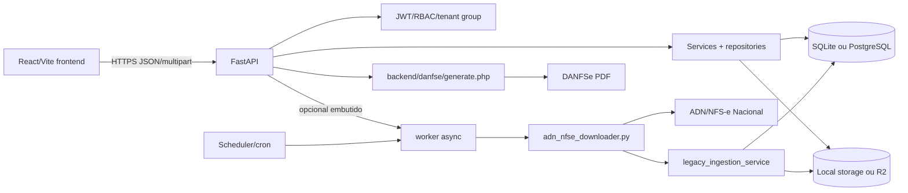
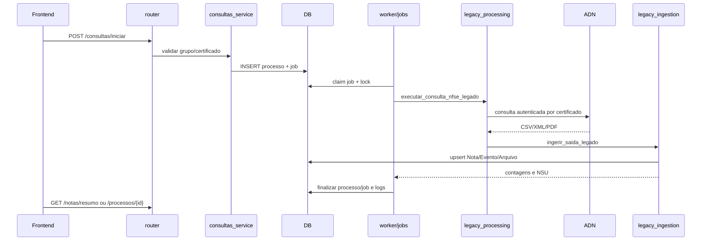

# Arquitetura real

## Diagrama de implantação

## Camadas e fronteiras

### Entrada HTTP

`backend/app/main.py` cria o `FastAPI`, executa o `lifespan`, inclui os 19 routers e instala CORS/cabeçalhos de segurança. Os routers em `backend/app/api/routers` convertem parâmetros e schemas em chamadas de serviço; eles também traduzem exceções de domínio para HTTP. `backend/app/api/deps.py` injeta `Session`, storage, usuário e isolamento por grupo.

### Contratos

`backend/app/schemas` contém modelos Pydantic para filtros, respostas, certificados, processos, notas e administração. Aliases são mantidos para compatibilidade com o frontend e com rotas legadas. O frontend tipa o mesmo contrato de forma informal em `frontend/src/lib/api.ts` e componentes.

### Serviços e repositories

Serviços pequenos encapsulam uma operação (`certificados_service`, `empresas_service`, `locks_service`, `secrets_service`). Serviços extensos (`legacy_ingestion_service`, `legacy_processing_service`, `notas_service`, `portal_support_service`) misturam validação, transformação, SQLAlchemy e efeitos de storage. Repositories são uma via preferencial, não uma regra: buscas `db.query` também aparecem diretamente em routers e serviços.

### Persistência

`db/models.py` define 16 entidades SQLAlchemy. `db/session.py` configura o engine, SQLite WAL/busy timeout e PostgreSQL pool; `init_db()` cria tabelas e `_ensure_runtime_columns()` executa alterações incrementais. Não há árvore de revisions Alembic versionada, embora Alembic esteja em `requirements.txt`.

### Processamento assíncrono

`consultas_service` cria `Processo` + `Job`; `worker/jobs.py` reclama, trava por empresa/certificado, atualiza estados e chama `legacy_processing_service`. `worker/worker.py` roda polling; `worker/scheduler.py` e o scheduler embutido em `main.py` enfileiram ciclos automáticos. Em configuração local o dry-run é padrão; em produção o compose desliga workers embutidos e usa processos separados.

### Compatibilidade legada

`legacy_processing_service` importa dinamicamente o módulo raiz `adn_nfse_downloader.py`, configura diretórios e interpreta o resultado. `legacy_ingestion_service` lê CSV/XML e varre arquivos, extrai namespaces locais, calcula campos fiscais, gera PDF espelho e registra arquivos. Alterar modelos ou nomes de storage sem atravessar esses dois módulos quebra a consulta real.

## Diagrama de consulta

## Configuração e execução

- `backend/app/core/config.py` lê `.env`; valores importantes são `DATABASE_URL`, `STORAGE_BACKEND`, `STORAGE_ROOT`, `API_KEY`, `JWT_SECRET`, `SECRETS_KEY`, flags de worker/scheduler, limites de download e CORS.
- `uvicorn backend.app.main:app` é o ponto de entrada da API.
- `python -m backend.app.worker.worker` executa worker externo; `python -m backend.app.worker.scheduler` executa scheduler.
- `docker-compose.yml` separa API, worker e scheduler e define `API_WORKER_ENABLED=false` e `EMBEDDED_SCHEDULER_ENABLED=false` na API.
- `Dockerfile` roda `backend.app.scripts.migrar_banco` antes do Uvicorn; produção exige migração explícita.

## Segurança arquitetural

PBKDF2-SHA256 (600k iterações) protege senhas; JWT HS256 dura por padrão 24h; API key protege rotas de serviço. `deps.py` aplica papéis `admin/operator/leitura` e tenant por `Empresa.grupo`. Upload de certificado é limitado e o storage normaliza chaves/path traversal. A fronteira normal é aplicação: o modelo SQLAlchemy não declara políticas RLS; há scripts opcionais de hardening Supabase (`app/scripts/aplicar_seguranca_rls.py`, `auditar_rls_supabase.py`) que precisam ser executados e verificados separadamente.

## Divergências intencionais a observar

1. Arquitetura documentada como camadas não corresponde a todas as chamadas reais de SQL.
2. Existe um adaptador `/nfse` para contratos antigos em paralelo com `/notas`.
3. O frontend de cadastro chama `/auth/criar-conta`, inexistente no backend deste commit.
4. `GET /auth/grupos` existe, mas é protegido por administrador apesar do nome sugerir endpoint público.
5. Existem duas definições de `exportar_conferencia_xlsx` em `portal_support_service.py`; a segunda sobrescreve a primeira em importação.
