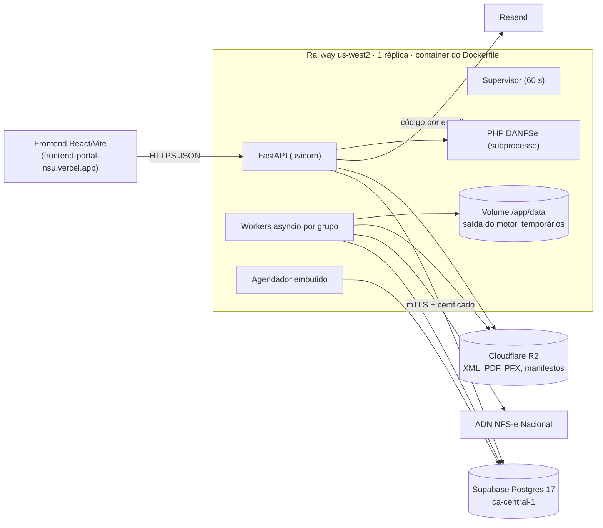

# Arquitetura atual

> Verificado contra o código em 15/10/2026, commit `ae9d4e2d` (branch `ajustes/seguranca-admin-paginacao`, não implantada). Implantação e números do Railway: medição de 01–08/10.

## Implantação



- **Build:** o Railway mostra o builder `RAILPACK`, mas o log de build segue os passos do `Dockerfile` (pip, `composer install`). O `CMD` roda `python -m backend.app.scripts.migrar_banco` e depois `uvicorn`.
- **Um processo faz tudo:** com `API_WORKER_ENABLED` e `EMBEDDED_SCHEDULER_ENABLED` no padrão `True`, a mesma instância serve a API, consome a fila e agenda os ciclos. O `docker-compose.yml` modela a alternativa (api, worker e scheduler separados), não usada em produção (ADR-0006).
- **Regiões diferentes:** aplicação em `us-west2` e banco em `ca-central-1`. Cada consulta SQL custa dezenas de ms (`/db/health` ≈ 280 ms). Ver ARCH-004.
- **Pool de conexões em produção:** 5 + 10 de overflow, compartilhado entre API e worker.

## O que roda dentro do processo (`backend/app/main.py`)

| Tarefa | Onde | Frequência | Observação |
|---|---|---|---|
| `init_db` | `lifespan` | startup | Só migra em SQLite; em Postgres a migração é o `CMD` |
| Limpeza de ZIP e PFX temporários | `lifespan` | startup | |
| Recálculo de valores líquidos salvos | `valor_liquido_backfill_service` | startup (tarefa) | |
| Worker por grupo (`_run_api_worker`) | `asyncio.to_thread(processar_proximo_job)` | contínuo, com espera de 0,2–2 s quando a fila está vazia | `API_WORKER_CONCURRENCY` workers por grupo |
| Supervisor (`_supervisionar_grupos`) | | a cada 60 s | Recupera jobs sem heartbeat, roda o vigia da operação (`operacao_service`), limpa logs 1×/dia, sobe workers para grupos novos e recria o agendador se a tarefa dele terminou |
| Agendador (`_run_consultas_scheduler`) | | a cada `max(5 s, CONSULTAS_SCHEDULER_SLEEP)` | Enfileira por grupo quando `proximo_ciclo_em` vence. Exceção no ciclo vai para o log e o laço continua; cada volta sem erro grava o "último tick" (`operacao_service.registrar_tick_agendador`). Se a tarefa terminar mesmo assim, o supervisor sobe outra (`_recriar_agendador_se_parado`) |

## Camadas

```text
api/routers/*      HTTP, validação de entrada, auth e filtro por grupo (deps.py)
schemas/*          contratos Pydantic, aliases, campos somente leitura
services/*         regras de negócio, orquestração, integrações (ADN, R2, PHP, Resend)
repositories/*     consultas reutilizáveis (nem todo service usa: muitos fazem db.query direto)
db/models.py       23 tabelas SQLAlchemy; db/session.py engine + migrate_db
worker/*           claim de job, execução, agendador avulso
adn_nfse_downloader.py   motor legado do ADN, carregado dinamicamente por job
backend/danfse/    biblioteca PHP do DANFSe (dompdf)
```

Boundaries reais (não confundir):

- **Status fiscal × fila:** `nfse_status_service` × `operational_fields_service`.
- **Motor legado × ingestão:** o motor só grava arquivos em disco (`data/saida_adn_nfse/empresas/empresa_{id}_cert_{id}/`); quem grava no banco e no R2 é a ingestão.
- **Banco × storage:** não há transação comum. O arquivo vai ao R2 antes do commit da linha; órfãos são tratados por `scripts/limpar_orfaos_storage` e `reconciliar_storage`.

## Fluxos

### Login e grupo
`POST /auth/login` → limites no banco (`RateLimiterBanco`, tabela `tentativas_acesso`: IP+e-mail 8/5 min, conta 20/15 min, IP 60/15 min) → `auth_service.autenticar` (PBKDF2, tempo constante) → JWT HS256 `{sub, empresa_id, ver, iat, exp}` de 12 h → em cada request `deps.get_current_usuario` carrega o usuário, confere ativo, e-mail verificado, `token_version` e grupo ativo. Token com `escopo` (sessão admin) é recusado como token do portal. O grupo do usuário é o filtro de tudo (REG-001).

### Painel admin (sessão própria)
`/auth/2fa/iniciar` → `/auth/2fa/confirmar` (TOTP RFC 6238, `core/totp.py`) → `POST /auth/admin/sessao` (senha + código) → token `escopo=admin` de `ADMIN_SESSAO_MINUTOS` (30) → header `X-Admin-Token`. O router `admin` inteiro depende de `require_admin_sessao` (403 `admin_sessao_necessaria`) e de `auditar_admin` (grava as alterações em `auditoria_painel_admin`). REG-043.

### Consulta ao ADN (coração do sistema)
```text
agendador (15 min) ou POST /consultas/iniciar | /releitura-mes-anterior | autocadastro
  -> consultas_service.enqueue_consultas_pendentes
       list_certificados_elegiveis (decifra a senha de cada certificado)
       pula certificado com processo pendente/rodando
       cria Processo + Job (pendente)
worker: jobs_repo.claim_next_pending_job (UPDATE condicional) -> processar_job_consulta_nfse_real
  -> lock (empresa, certificado) -> job/processo "rodando"
  -> manter_lease: thread de heartbeat a cada 30 s (job, processo, lock)
  -> legacy_processing_service.executar_consulta_nfse_legado
       PFX do R2 -> arquivo temporário; senha decifrada
       planejar_inicio_consulta (NSU confirmado − 50, ou releitura profunda)
       thread de ingestão incremental (a cada ~3 s lê index_nfse.csv e grava no banco/R2)
       motor: GET DFe/{nsu}?lote=true, até 1000 chamadas, para em E2220 ou 5 vazios
       ingestão final (commit por nota)
       NSU central = min(maior NSU obtido, primeiro NSU com erro − 1)
       enriquecimento de CNPJ (Invertexto, opcional)
  -> job/processo "finalizado" (com aviso se houve documentos fora do banco) ou "erro"
  -> lock liberado, PFX temporário apagado
```
Tempos: a chamada ao ADN tem timeout de 240 s e até 5 tentativas (espera de 20–300 s em 429/502/503/504). No log de 07–08/10, cada ciclo enfileirou 37–47 dos 78 certificados; os demais ainda estavam na fila do ciclo anterior.

### Ingestão de um documento
`index_nfse.csv` (+ arquivos fora do índice) → `nfse_status_service.classificar_xml` → evento: registra, vincula à nota e regenera o PDF com carimbo; nota: monta os dados fiscais e retenções (`retencoes_calculo_service`), upsert por `(empresa, chave)`, XML no R2, PDF espelho (PHP) no R2, linhas em `arquivos` → commit por linha. Nota inalterada (mesmo XML, NSU e arquivos) é pulada.

### Conferência
`PATCH /notas/{id}/conferencia` → `notas_service.salvar_conferencia` (409 sem `retificar` quando já há responsável) → histórico em `notas_conferencia_historico`.

### Listagem de notas
`GET /notas` → `notas_service` → `notas_repo` com paginação por cursor (keyset): chave de ordenação por `sort` (`recentes` = `importado_em, updated_at, id`; `emissao` = data de emissão + id), cursor opaco (`codificar_cursor`/`decodificar_cursor`), próxima página no cabeçalho `X-Next-Cursor` (exposto no CORS). OFFSET continua aceito para clientes antigos. As varreduras internas (`_percorrer_repo`) também andam por cursor. No SQLite as comparações de data usam `julianday`. REG-044.

### Exportação
`POST|GET /notas/download-lote` → `notas_service.buscar_notas_exportacao` (sem canceladas/substituídas; teto 10.000) → até 16 threads baixam do R2 → ZIP temporário → resposta e apagamento. `POST /relatorios/conferencia` → XLSX (teto 20.000). Tudo síncrono dentro da requisição.

### DANFSe avulso
`POST /api/danfse/gerar` (operador) → valida raiz NFS-e e tamanho → `php generate.php` com timeout de 60 s → PDF.

## Cadeias de dependência

```text
main.py ─┬─ api/routers/* ── api/deps.py ── db/session.py ── db/models.py
         │                └─ services/* ── repositories/* ── models.py
         ├─ worker/worker.py ── worker/jobs.py ── legacy_processing_service ─┬─ adn_nfse_downloader.py (import dinâmico)
         │                                                                  ├─ legacy_ingestion_service ─┬─ nfse_status_service
         │                                                                  │                            ├─ retencoes_* / operational_fields
         │                                                                  │                            ├─ danfse_service (PHP)
         │                                                                  │                            └─ storage_service (R2)
         │                                                                  └─ nsu_control_service / secrets_service
         ├─ consultas_service / operacao_service
         └─ core/config.py (Settings, lido no import por todos)
```

Ler juntos: `consultas_service` + `nsu_control_service` + `legacy_processing_service` + `jobs.py`; `legacy_ingestion_service` + `nfse_status_service` + `operational_fields_service`; `notas_service` + `notas_repo` + `schemas/notas.py`.

## Características de arquitetura prioritárias

1. **Completude da coleta:** nenhuma nota do ADN pode faltar sem aviso.
2. **Integridade e auditabilidade fiscal.**
3. **Isolamento entre grupos.**
4. **Operabilidade:** detectar parada em minutos. Hoje é o ponto mais fraco (ARCH-008; o agendador ganhou tick e alerta próprios).
5. **Desempenho das telas com o worker rodando** (ARCH-002, ARCH-004).

Monólito modular é a escolha adequada para o tamanho atual (≈ 84 empresas, 2 equipes). O ponto a decidir é separar o **processo** do worker da API, não dividir em serviços.

## Plano de carga — alterações locais de 15/10/2026

Verificado sobre `2d05450f` + alterações locais, publicadas no backend `4e4302c0`: a API e o worker continuam no mesmo pool, mas o limitador de tentativas usa um pool Postgres próprio de até 3 conexões, com espera/execução limitadas. O cursor usa sentinelas SQL fixas para coincidir com os índices funcionais, inclusive em planos preparados genéricos. Os ciclos automáticos espaçam a disponibilidade dos certificados dentro do intervalo; pedidos manuais/forçados mantêm execução imediata. Detalhes e evidências: `PLANO_CARGA_BANCO.md` e `medicoes/carga-banco-2026-10-15.json`.
