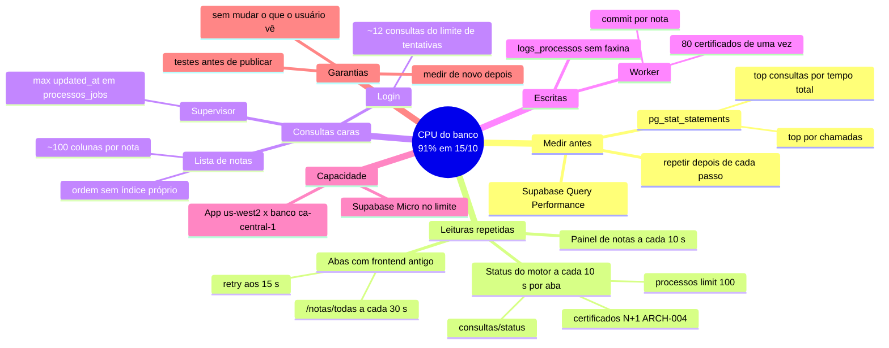

# Plano: reduzir a carga (CPU) do banco

> Criado em 15/10/2026, depois do incidente do deploy (ver "Contexto"). Base de produção: commit `5221ce60` (main). Execução iniciada em 15/10/2026; a coluna "Situação" distingue medição, implementação local e publicação.
>
> Manter este arquivo atualizado: cada passo feito ganha data, commit e resultado medido na coluna "Situação".

## Contexto

Em 15/10/2026 o banco do Supabase (plano Micro, ~1 GB de memória) chegou a **91% de CPU**, com o disco quase parado (36 IOPS). A memória não era o problema: o Postgres usava ~434 MB e o resto era cache, que é o uso esperado.

Com isso:
- o deploy entrou em loop de reinício (resolvido pelo hotfix `5221ce60`; ver `CHANGELOG.md`);
- depois de no ar, o login levou de 5 a 28 s, e às vezes mais de 60 s.

Mesmo com o worker e o agendador desligados (`API_WORKER_ENABLED=false`, `EMBEDDED_SCHEDULER_ENABLED=false` desde 19:41 UTC), o login continuou lento e o próprio conector do Supabase não conseguia conectar. A ação imediata foi aumentar a computação do Supabase; este plano trata da causa no código.

## Mapa mental

## Passos

Ordem: primeiro medir, depois o que tem ganho alto e zero efeito para quem usa.

| # | Passo | Onde | Efeito para quem usa | Ganho esperado | Situação |
|---|---|---|---|---|---|
| 0 | Aumentar a computação do Supabase (Micro → Small ou Medium) | painel do Supabase | alguns minutos fora do ar | alto (folga imediata) | em andamento pelo usuário (15/10) |
| 1 | Medir: `pg_stat_statements` (top por tempo total e por chamadas) e Query Performance do Supabase | banco (só leitura) | nenhum | confirma a ordem dos passos | medição SQL concluída em 15/10: top 10 por tempo e chamadas salvo em `medicoes/carga-banco-2026-10-15.json`; estatísticas acumuladas desde 15/07. CPU média de 30 min / painel Query Performance ainda não capturados |
| 2 | Status do motor e painel a cada 30 s (hoje 10 s), parando com a aba escondida | frontend `features/motor/hooks/useLiveStatus.ts`, `features/notas/pages/Dashboard.tsx`, `VITE_STATUS_REFRESH_MS` | números atualizam a cada 30 s | alto | publicado no frontend em 15/10: commit `e98299a`, deploy `dpl_2DfCPKs4TE4hMWya3H46Bs6bLN9n`, domínio `frontend-portal-nsu.vercel.app`; bundle público confirmou polling mínimo 30 s e login 60 s; HTTP e CORS 200 |
| 3 | `/certificados` numa consulta só (sem N+1) | `repositories/certificados_repo.list_certificados` (ARCH-004) | nenhum (mais rápido) | alto | publicado em 15/10 no Railway, deploy `753ac481-3d02-49c1-91b6-cfc4f929d844`, commit `4e4302c0`. `joinedload(Certificado.empresa)`; regressão comprova 1 SELECT para serializar empresas de vários certificados, mantendo filtro de grupo |
| 4 | Índice que bate com a ordem do cursor da lista de notas (`importado_em, updated_at, id`) | revisão Alembic nova; `notas_repo.chaves_ordem` | nenhum | alto | publicado em 15/10 no Railway, deploy `753ac481-3d02-49c1-91b6-cfc4f929d844`, commit `4e4302c0`. revisão `0006_indices_carga_banco`, índices funcionais COALESCE das ordens recentes e emissão no Postgres; compilação SQL validada. Índices confirmados no PostgreSQL |
| 5 | Lista de notas carregando só as colunas da tabela; o resto ao abrir a nota | `notas_repo`/`notas_service` (`load_only`/`defer`), `schemas/notas.py` | nenhum | médio | revisado em 15/10; pendente: DTO atual tem 120 campos, incluindo quase todas as colunas fiscais. Exige mapear campos da tabela versus drawer e um contrato explícito de lista resumida; não remover campos silenciosamente |
| 6 | Índice `processos_jobs (status, updated_at)` para o supervisor | revisão Alembic | nenhum | médio | publicado em 15/10 no Railway, deploy `753ac481-3d02-49c1-91b6-cfc4f929d844`, commit `4e4302c0`. índice `(status, updated_at)` na revisão 0006; migração SQLite validada de forma idempotente. Índice confirmado no PostgreSQL |
| 7 | Faxina de `logs_processos` antigos (retenção) | `operacao_service` / script com simulação (ARCH-008) | logs antigos somem do painel | médio | retenção escolhida pelo usuário: 90 dias. Simulação SQL em 15/10, 21:41 UTC: 8 elegíveis / 970.205 logs. Nenhum removido; script `limpar_logs_antigos --dias 90` criado, com `--aplicar` explícito; retenção automática ainda não ativada |
| 8 | Worker espalhando os certificados ao longo do ciclo, sem pico após parada | `consultas_service.enqueue_consultas_pendentes` | notas chegam no mesmo ciclo | médio (picos) | publicado em 15/10 no Railway, deploy `753ac481-3d02-49c1-91b6-cfc4f929d844`, commit `4e4302c0`. `available_at` distribui certificados elegíveis pelo intervalo do ciclo automático. Pedidos manuais e forçados continuam imediatos; teste cobre os três modos |
| 9 | Limite de tentativas do login mais leve, com tempo máximo curto e reserva em memória se o banco demorar | `core/rate_limit.RateLimiterBanco` | nenhum; o login não trava | baixo, mas evita timeout | publicado em 15/10 no Railway, deploy `753ac481-3d02-49c1-91b6-cfc4f929d844`, commit `4e4302c0`. INSERT condicionado à contagem da janela, sem DELETE por chave a cada login; índice `(chave, criado_em)`, trava por chave no Postgres, pool dedicado (1+2), espera de pool 1 s, conexão 2 s, comandos 1 s e lock 500 ms. Reserva acompanha tentativas saudáveis. Login fictício devolveu 401 esperado, sem aviso de fallback do limitador nos logs |
| 10 | Tempo de espera do login no frontend maior que 15 s | frontend `shared/api/http.ts` | só no login | evita erro falso | publicado no frontend em 15/10: commit `e98299a`, deploy `dpl_2DfCPKs4TE4hMWya3H46Bs6bLN9n`, domínio `frontend-portal-nsu.vercel.app`; bundle público confirmou polling mínimo 30 s e login 60 s; HTTP e CORS 200 |
| 11 | ~~Religar o worker e o agendador~~; medir CPU novamente | Railway (variáveis) | consultas ao ADN voltam | — | reativação concluída em 15/10, 21:29 UTC (18:29 Brasília), deploy `ed71dd6f-a37c-490d-ac7d-fc8ba5922cef`, commit `5221ce60`; job 44838 finalizado sem erro às 21:39:23 UTC (confirmado no banco). CPU média após retomada ainda pendente |

## Como validar cada passo

1. Antes de mexer: guardar o top 10 do `pg_stat_statements` e a CPU média de 30 min no Supabase.
2. Depois de publicar: repetir as duas medições no mesmo horário de uso.
3. Registrar aqui (Situação) e no `CHANGELOG.md`.

## Riscos

- Índices novos em produção: criar com revisão Alembic idempotente. A tabela `notas` tem ~45 mil linhas, então `CREATE INDEX` leva segundos, mas trava escrita nesse tempo. Rodar fora do horário de importação.
- Passo 5 muda o que o endpoint devolve na lista: conferir que o frontend só usa as colunas mantidas (mapa do frontend, `40-api/ENDPOINTS.md` e `notas/BUSINESS-RULES.md`).
- Passo 7 apaga dados de log: script com simulação antes do `--aplicar`.

## Execução de 15/10 — evidências e limites

- **CONFIRMADO:** listagens antigas com OFFSET consumiram 65.159.250,55 ms em 15.233 chamadas (média histórica 4.277,51 ms); outra forma equivalente teve média de 5.424,90 ms. Não são medições da latência de hoje.
- **CONFIRMADO:** alto volume histórico de UPDATE de arquivos/notas; a capacidade não deve ser avaliada só pela leitura do portal. Os dez maiores custos e as contagens estão no JSON de medição.
- **CONFIRMADO:** retenção de 90 dias afeta apenas 8 registros na fotografia; ganho imediato de CPU não foi medido.
- **NAO_DETERMINADO:** plano de computação atual do Supabase e CPU média dos últimos 30 minutos. Não foram inferidos da rapidez de uma consulta.
- Backend publicado no commit `4e4302c0` por upload direto; frontend publicado no commit `e98299a` na Vercel. O GitHub ainda não recebeu este commit.
- O próximo checkpoint é revisar/publicar a alteração local e comparar deltas de `pg_stat_statements` e CPU em janelas equivalentes. Não zerar os contadores globais para medir.
- A revisão 0006 cria índices durante a migração; programar aplicação com baixa atividade de escrita e conferir EXPLAIN no PostgreSQL. Compilação SQL e SQLite não substituem esse teste.

## Validação local desta rodada

- Backend: suíte completa com 341 aprovados e 2 ignorados. Depois do ajuste final dos literais do cursor, 8 testes direcionados de cursor/carga aprovados. Migração também testada partindo de banco sem os novos índices.
- Frontend: lint aprovado, 53 testes aprovados, TypeScript e build aprovados. O check global parou em avisos de formatação de 140 arquivos (incluindo muitos não alterados); somente os quatro arquivos de código desta rodada foram formatados. Build com aviso de asset e chunk grande já presentes, sem impedir a geração.
- Limites: frontend publicado e verificado por HTTP, scripts e CORS; não houve exclusão de logs nem medição da CPU global. Migração PostgreSQL e EXPLAIN pós-publicação confirmados no backend. Aumento de computação do Supabase ainda não reconferido. Passo 5 continua pendente.

## Publicação e teste de 15/10/2026

Backend publicado diretamente pela CLI do Railway a partir do checkout isolado `deploy/carga-banco-20261015`, commit `4e4302c0` (sem incluir as remoções locais anteriores). Deploy `753ac481-3d02-49c1-91b6-cfc4f929d844`, startup às 23:16 UTC. Migração 0006 e quatro índices confirmados no PostgreSQL; três rotas de saúde com HTTP 200, login de conta fictícia com 401 esperado e sem fallback do limitador nos logs consultados. Jobs 44873 e 44874 finalizaram sem erro. O primeiro teve um deadlock incremental conhecido, recuperado pela ingestão final (ARCH-003 continua aberto).

Na consulta representativa `SELECT id` das 100 notas mais recentes, EXPLAIN ANALYZE mudou de Seq Scan + Sort sobre 48.023 linhas (123,982 ms) para Index Scan de 100 linhas (1,168 ms). São amostras isoladas, não uma medição de CPU global ou do endpoint inteiro. Evidência: `medicoes/deploy-carga-banco-2026-10-15.json`.

Passos 3, 4, 6, 8 e 9 publicados no backend. Passos 2 e 10 publicados na Vercel, commit `e98299a`, deploy `dpl_2DfCPKs4TE4hMWya3H46Bs6bLN9n`. Passo 5, CPU média de 30 minutos, confirmação do compute do Supabase e ativação/execução da retenção continuam pendentes. GitHub não recebeu o commit: uma conexão retornou 404 e a outra 403 por conta suspensa; o serviço foi publicado por upload direto. Uma futura publicação da branch main precisa incorporar este commit para não perder as otimizações.

Validação final do frontend: HTML e script público HTTP 200, backend correto no bundle, mínimo de 30 s e timeout de login de 60 s confirmados, preflight CORS 200 para o domínio público. Testes 53/53 e build repetidos após remover duas duplicações introduzidas na reaplicação do ajuste. O build inicial com erro não foi promovido. Agendador do backend confirmado no ciclo de 23:30 UTC, com quatro novos jobs distribuídos até 23:41:33 UTC.
