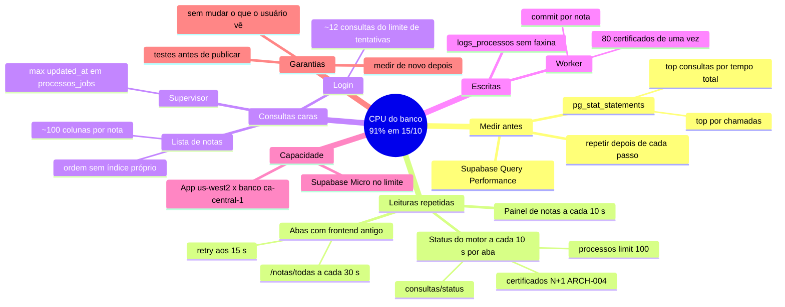

# Plano: reduzir a carga (CPU) do banco

> Criado em 15/10/2026, depois do incidente do deploy (ver "Contexto"). Verificado contra o código em 15/10/2026, commit `5221ce60` (main). Fonte das hipóteses: código, logs do Railway e métricas do Supabase de 15/10. **Nenhum passo executado ainda**, salvo onde a tabela diz o contrário.
>
> Manter este arquivo atualizado: cada passo feito ganha data, commit e resultado medido na coluna "Situação".

## Contexto

Em 15/10/2026 o banco do Supabase (plano Micro, ~1 GB de memória) chegou a **91% de CPU**, com o disco quase parado (36 IOPS). A memória não era o problema: o Postgres usava ~434 MB e o resto era cache, que é o uso esperado.

Com isso:
- o deploy entrou em loop de reinício (resolvido pelo hotfix `5221ce60`; ver `CHANGELOG.md`);
- depois de no ar, o login levou de 5 a 28 s, e às vezes mais de 60 s.

Mesmo com o worker e o agendador desligados (`API_WORKER_ENABLED=false`, `EMBEDDED_SCHEDULER_ENABLED=false` desde 19:41 UTC), o login continuou lento e o próprio conector do Supabase não conseguia conectar. A ação imediata foi aumentar a computação do Supabase; este plano trata da causa no código.

## Mapa mental

## Passos

Ordem: primeiro medir, depois o que tem ganho alto e zero efeito para quem usa.

| # | Passo | Onde | Efeito para quem usa | Ganho esperado | Situação |
|---|---|---|---|---|---|
| 0 | Aumentar a computação do Supabase (Micro → Small ou Medium) | painel do Supabase | alguns minutos fora do ar | alto (folga imediata) | em andamento pelo usuário (15/10) |
| 1 | Medir: `pg_stat_statements` (top por tempo total e por chamadas) e Query Performance do Supabase | banco (só leitura) | nenhum | confirma a ordem dos passos | pendente |
| 2 | Status do motor e painel a cada 30 s (hoje 10 s), parando com a aba escondida | frontend `features/motor/hooks/useLiveStatus.ts`, `features/notas/pages/Dashboard.tsx`, `VITE_STATUS_REFRESH_MS` | números atualizam a cada 30 s | alto | pendente |
| 3 | `/certificados` numa consulta só (sem N+1) | `repositories/certificados_repo.list_certificados` (ARCH-004) | nenhum (mais rápido) | alto | pendente |
| 4 | Índice que bate com a ordem do cursor da lista de notas (`importado_em, updated_at, id`) | revisão Alembic nova; `notas_repo.chaves_ordem` | nenhum | alto | pendente |
| 5 | Lista de notas carregando só as colunas da tabela; o resto ao abrir a nota | `notas_repo`/`notas_service` (`load_only`/`defer`), `schemas/notas.py` | nenhum | médio | pendente |
| 6 | Índice `processos_jobs (status, updated_at)` para o supervisor | revisão Alembic | nenhum | médio | pendente |
| 7 | Faxina de `logs_processos` antigos (retenção) | `operacao_service` / script com simulação (ARCH-008) | logs antigos somem do painel | médio | pendente |
| 8 | Worker espalhando os certificados ao longo do ciclo, sem pico após parada | `consultas_service.enqueue_consultas_pendentes` | notas chegam no mesmo ciclo | médio (picos) | pendente |
| 9 | Limite de tentativas do login mais leve, com tempo máximo curto e reserva em memória se o banco demorar | `core/rate_limit.RateLimiterBanco` | nenhum; o login não trava | baixo, mas evita timeout | pendente |
| 10 | Tempo de espera do login no frontend maior que 15 s | frontend `shared/api/http.ts` | só no login | evita erro falso | pendente |
| 11 | Religar o worker e o agendador e medir de novo | Railway (variáveis) | consultas ao ADN voltam | — | pendente: só depois do passo 0 |

## Como validar cada passo

1. Antes de mexer: guardar o top 10 do `pg_stat_statements` e a CPU média de 30 min no Supabase.
2. Depois de publicar: repetir as duas medições no mesmo horário de uso.
3. Registrar aqui (Situação) e no `CHANGELOG.md`.

## Riscos

- Índices novos em produção: criar com revisão Alembic idempotente. A tabela `notas` tem ~45 mil linhas, então `CREATE INDEX` leva segundos, mas trava escrita nesse tempo. Rodar fora do horário de importação.
- Passo 5 muda o que o endpoint devolve na lista: conferir que o frontend só usa as colunas mantidas (mapa do frontend, `40-api/ENDPOINTS.md` e `notas/BUSINESS-RULES.md`).
- Passo 7 apaga dados de log: script com simulação antes do `--aplicar`.
